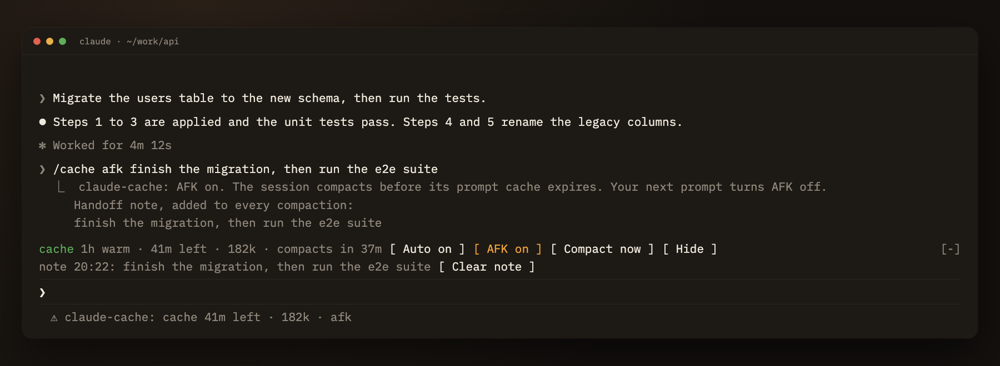

<p align="center"></p>

<h1 align="center">cachekeeper</h1>

<p align="center">
  <a href="https://github.com/the-cybersapien/claude-cache/actions/workflows/ci.yml"></a>
</p>

cachekeeper is a Claude Code plugin that compacts an idle session while its prompt cache is still warm.



▶ [Watch the 37-second demo on YouTube](https://youtu.be/WjQTau5LCMY)

Anthropic holds a prompt cache for 5 minutes or 1 hour. Step away longer than that and your next message writes the whole context back into the cache, at 1.25x the input price for a 5-minute cache and 2x for a 1-hour one. On a 180k-token session with a 1-hour cache, you pay for 360k input tokens before the model reads a word of your question.

cachekeeper compacts the session before the cache expires. The compaction reads your conversation at the cache-read rate, and your next message writes a 15k summary to the cache in place of 180k of history.

## Features

### Idle auto-compact

With a 1-hour cache, a session idle for 55 minutes compacts itself. Switch it on or off per session with `/cache on`, `/cache off` or the band's **Auto** button.

cachekeeper leaves a session alone when:

- the context fills less than 30% of the model's window, where a compaction saves too little to pay for its own work;
- the cache has a 5-minute TTL, where idle compaction would fire at every short pause (AFK mode still works there);
- you have sent nothing since the last compaction, whether cachekeeper ran it, you typed `/compact`, or Claude Code auto-compacted.

### Warm cache only

A compaction has to start at least 30 seconds before the cache expires. If your laptop sleeps through that window, cachekeeper skips the compaction, because a cold one would pay the full rewrite you wanted to avoid. `/cache compact` refuses a cold cache for the same reason. After each compaction, a toast shows how many tokens it read from the cache.

### AFK mode and the handoff note

Before you leave, type `/cache afk finish the migration, then run e2e`. cachekeeper saves your text as a handoff note and compacts 4 minutes before a 1-hour cache expires, or 1 minute before a 5-minute one. Leave out the text and the model writes the note from the warm cache, which also restarts the cache timer. You can also tell Claude "I'm heading out, leave this running", and Claude calls the plugin's `afk` tool with a note of its own.

cachekeeper adds the note to the instructions of every compaction in the session, your `/compact` and Claude Code's auto-compact included, and the summary keeps it under a "Handoff note" heading. Your next prompt turns AFK off and shows you the note. `/cache note <text>` saves a note without going AFK, and `/cache note clear` drops it.

### Countdown and warnings

The status line reads `cache 42m left · 180k · auto`. A band above the prompt shows the same countdown with **Auto**, **AFK**, **Compact now** and **Clear note** buttons, in the terminal and in the desktop app's Code tab.

- Come back to an expired cache and a toast tells you how many tokens your next message rewrites.
- Switch models with a warm cache and a toast shows what the rewrite costs at API prices.

cachekeeper reads your account's TTL from the `cache_creation.ephemeral_1h_input_tokens` and `ephemeral_5m_input_tokens` counts in the session transcript. Before the first response, it falls back to `CLAUDE_CODE_PROMPT_CACHE_TTL`, the `promptCacheTtl` setting, `FORCE_PROMPT_CACHING_5M` and `ENABLE_PROMPT_CACHING_1H`.

## Commands

| Command | Effect |
| --- | --- |
| `/cache` | TTL, countdown, this session's mode, the note, cache tokens read and written, compactions |
| `/cache on` / `/cache off` | idle auto-compact for this session |
| `/cache afk [note]` / `/cache back` | AFK mode, with your note or one the model writes |
| `/cache note [text\|clear]` | show, save or drop the handoff note |
| `/cache compact` | compact now, if the cache is warm |
| `/cache band` | show or hide the band |

Focus the band with ctrl+x tab, then press `a` for Auto, `w` for AFK or `c` for Compact now.

## Settings

Change these in `/config`.

| Field | Default | Effect |
| --- | --- | --- |
| `autoCompactDefault` | on | idle auto-compact setting for each new session |
| `compactAfterMinutes` | 55 | idle minutes before a compaction, 1-hour cache only |
| `minContextPercent` | 30 | context share of the window before automatic compaction |
| `ttl` | auto | `auto`, `1h` or `5m` |
| `showBand` / `showStatus` | on | the band and the status-line entry |

## Install

In a Claude Code terminal session:

```
/plugin install cachekeeper --marketplace the-cybersapien/claude-cache
```

Answer `y` to add the marketplace, then pick a scope. From a shell:

```
claude plugin marketplace add the-cybersapien/claude-cache
claude plugin install cachekeeper@claude-cache
```

In the desktop app, plugins run in the Code tab. Start a new Code session after you install.

Until version 0.3.0 the plugin was called claude-cache. If you installed it under that name, swap it for the new one:

```
claude plugin uninstall claude-cache@claude-cache
claude plugin install cachekeeper@claude-cache
```

## What cachekeeper reads and runs

cachekeeper works through Claude Code and sends nothing over the network on its own. It has no telemetry and no server.

- **Your session transcript.** To learn whether your account gets a 5-minute or a 1-hour cache, cachekeeper runs `tail -c 262144` on the current session's transcript in `~/.claude/projects/`, so it reads only the last 256 KB. It runs no other program and reads no other files.
- **Settings and environment.** It reads the `promptCacheTtl` setting and four environment variables: `CLAUDE_CODE_PROMPT_CACHE_TTL`, `ENABLE_PROMPT_CACHING_1H`, `FORCE_PROMPT_CACHING_5M` and `HOME`.
- **Your Claude session.** When you go AFK without writing a note, cachekeeper asks your own session's model to write one. That request goes through Claude Code on your account, like any other turn. Compactions run through Claude Code's own compaction.
- **Local storage.** It saves handoff notes and two one-time flags in Claude Code's plugin storage on your machine.

## Work machines

If your company manages Claude Code on your machine, or you sign in with a Team or Enterprise plan, Claude Code runs a built-in security guard. It keeps plugins you install yourself out of some parts of a session, and cachekeeper works around most of that:

- **Your handoff note still reaches the model.** When you run `/compact` or Claude Code compacts on its own, the guard keeps cachekeeper from adding the note to the summary. cachekeeper attaches it to your next message instead. `/cache compact` and cachekeeper's own idle compactions keep the note in the summary as usual.
- **You still get one compaction per stretch of work.** cachekeeper notices your `/compact` within 15 seconds and waits for new conversation before it compacts again.
- **You lose the model-switch warning.** Switch models with a warm cache and no toast tells you what the rewrite costs.
- **Claude may lose the `afk` tool** if your company restricts MCP tools. `/cache afk` and the band's **AFK** button still work, and cachekeeper tells you once when this happens.

Two gaps remain. If Claude Code compacts in the middle of a long turn, cachekeeper may miss it and the note stays out of that summary. Right after a `/compact`, the band shows the old context size until Claude replies.

### Getting the full plugin

Your Claude Code administrator can install cachekeeper so the guard trusts it. They copy this repository to a folder only admins can change, then add this to your managed settings:

```json
{
  "extraKnownMarketplaces": {
    "claude-cache": { "source": { "source": "directory", "path": "/path/to/claude-cache" } }
  },
  "enabledPlugins": { "cachekeeper@claude-cache": true },
  "appendPlugins": ["cachekeeper@claude-cache"]
}
```

A copy installed from GitHub always counts as one you installed yourself, whoever installed it.

## Limits

- A compaction drops detail. cachekeeper asks the summarizer to keep the open task, next steps, decisions and file paths, and Claude Code keeps the full transcript on disk.
- Timers stop while your laptop sleeps. Sleep through the warm window and you get the cold-return toast with no compaction.
- cachekeeper sends no keepalive pings. On Pro and Max plans each ping spends quota, and Anthropic's consumer terms restrict automated traffic.

## Develop

From a clone of this repository:

```
claude --plugin-dir .               # a session with your checkout; it also writes .claude-plugin/types/ for tsc
npx -p typescript@5 tsc -p .
claude plugin test .
claude plugin validate .
```

CI runs these against Claude Code 2.1.310 and the latest release. [CLAUDE.md](CLAUDE.md) lists the design rules the code depends on.

## License

[Apache 2.0](LICENSE)
